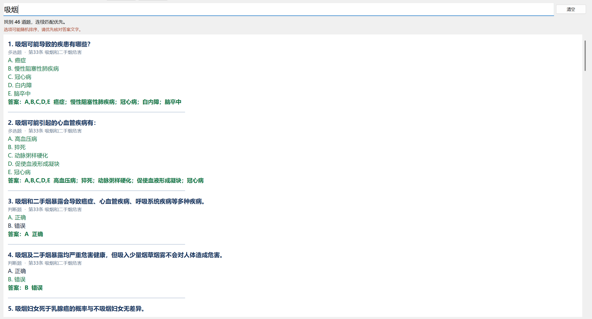
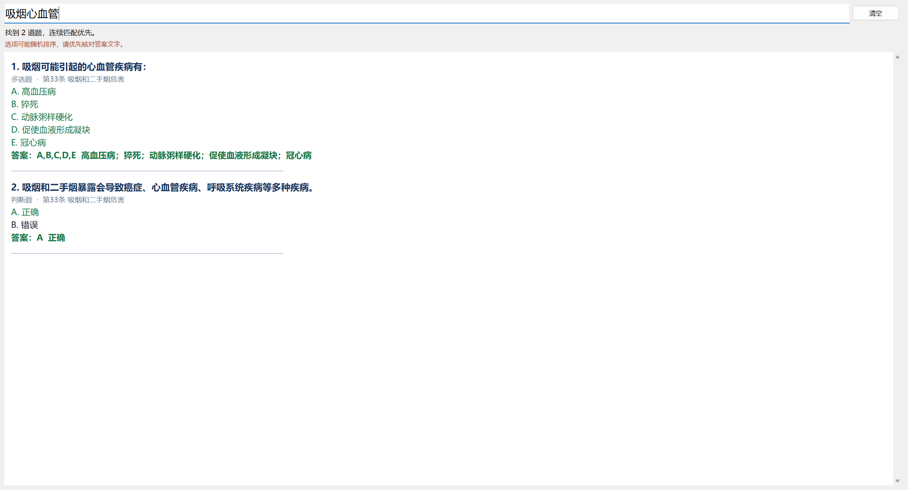

# 题库速查

一个 Windows 离线题库搜索工具。导入自己的 Excel 题库，输入题干的几个字，就能查看匹配的题目、选项和答案。首次打开时题库为空。

## 使用方法

1. 点击 **导入 Excel**，选择 `.xlsx` 文件。需要空白表格时，可以在 **导入格式 → 另存空白模板** 生成。
2. 用 **当前题库** 下拉框切换题库。搜索时可以输入连续片段，也可以跳过中间的字，或用空格分隔多个关键词。
3. 要移除题库，先选中它，再点 **删除题库** 并确认。操作移除软件内的导入副本，可用原 Excel 重新导入。

## 示例

### Excel 导入格式

第一行填写列名，每行一道题。**题目** 和 **答案** 必填，**题型** 和 **知识点** 可选。选择题支持 **选项A** 到 **选项F**。多选答案写在同一格，例如 `A、C、F` 或 `ACF`。判断题可以把“正确”和“错误”填为两个选项，填空题直接写答案。


### 关键词搜索

输入 `吸烟`，可以一次查看多道匹配题目。下图来自此前的演示题库。



### 跳字搜索

在同一份演示题库中输入 `吸烟心血管`，可以跳过题干中间的文字，将结果缩小到两道题。



### 查看答案

导入上图中的示例行后，输入 `三角形`、跳字输入 `三角几条边`，或输入 `三角形 边`，都能找到“一个三角形有几条边？”。结果会显示选项，并用绿色标出 **B · 3 条**。


## 运行源码

在 Windows 的 PowerShell 中使用带 Tkinter 的 Python 3.13。

```powershell
python -m pip install -r requirements.txt
python app.py
```

## 构建 Windows EXE

```powershell
python -m pip install -r requirements.txt pyinstaller==6.22.3
.\build.ps1
```

可执行文件位于 `dist/题库速查.exe`，可作为 GitHub Release 附件发布。导入的题库保存在本机的 `%LOCALAPPDATA%\题库速查\题库`。
